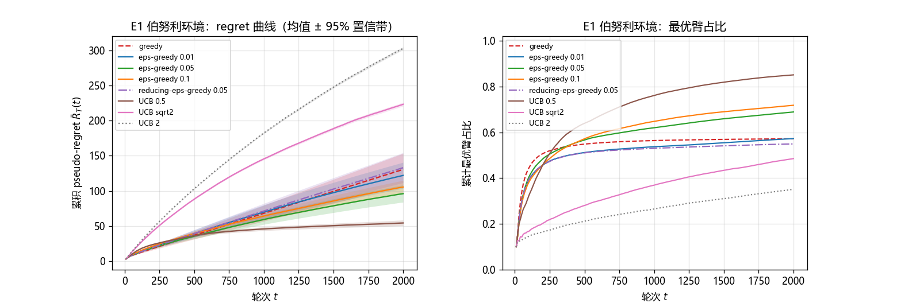
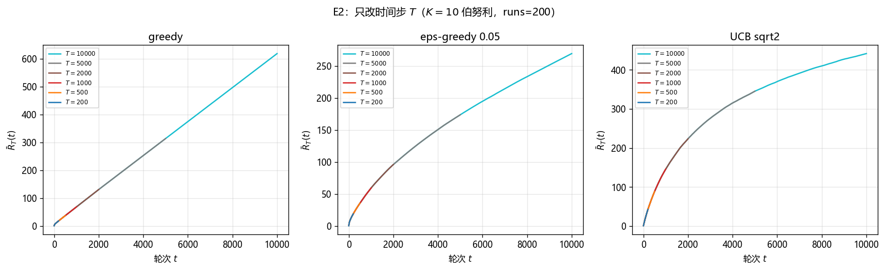
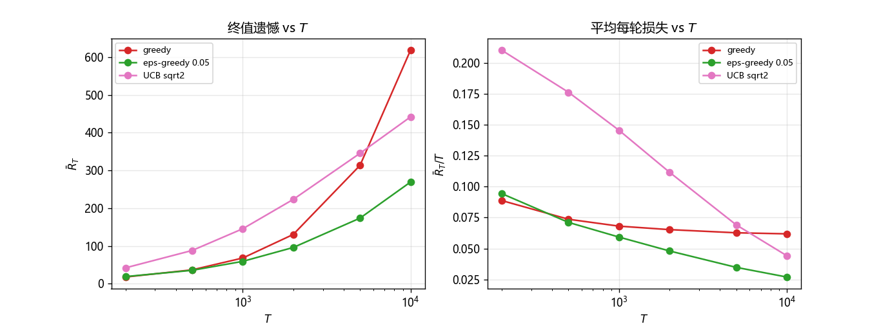
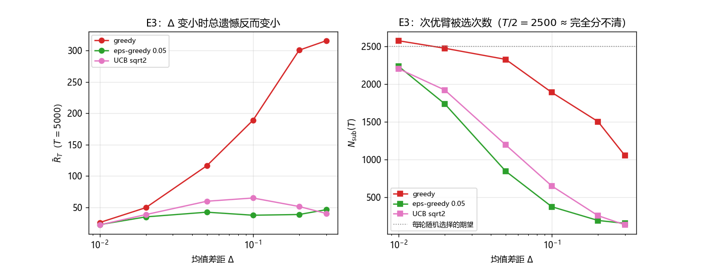
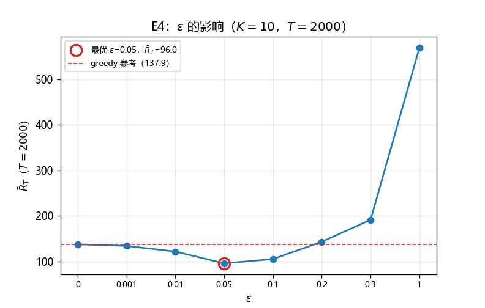
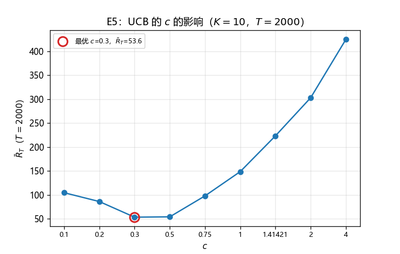
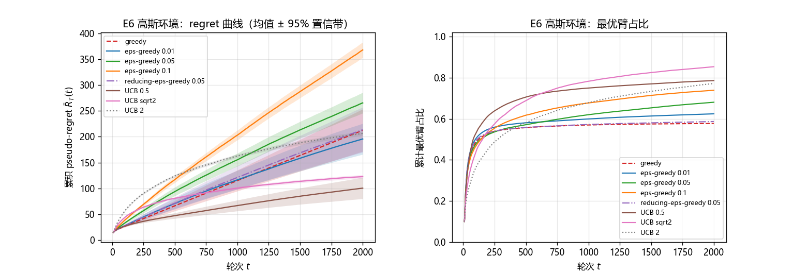

# RL Homework1 Report

## 1. 实现

考虑到 python 的运行效率问题，这里使用了 C++ 来实现三种算法（代码见 `test.cpp`），绘图使用了 DeepSeek 生成的 python 脚本 `plot_results.py`。三种算法的单次选择时间复杂度均为 $O(K)$，其中 $K$ 是臂的数量。

### 基类实现

由于三个算法的区别仅在于每轮选臂的方式不同，所以先实现基类 `Solver`：

```cpp
class Solver {
protected:
	std::vector<uint64_t> N_; // 每个臂被选了多少次
	std::vector<double> S_; // 每个臂的累计贡献

	double mean(int i) const {
		static const double oo = std::numeric_limits<double>::infinity();
		return N_[i] == 0 ? +oo : S_[i] / static_cast<double>(N_[i]); // 三个算法中没被选过的都会优先选一次，所以直接设为 +oo
	}
public:
	explicit Solver(int K) : N_(K, 0), S_(K, 0.0) {  }
	virtual ~Solver() = default;
	
	virtual int select(uint64_t t, std::mt19937_64 &rng) = 0;
	void update(int id, double r) { ++N_[id], S_[id] += r; }
	std::vector<uint64_t> counts() const { return N_; }

	void set(const std::vector<uint64_t> &N, const std::vector<double> &S) { N_ = N, S_ = S; }
	int random_select_max(const std::vector<double> &score, std::mt19937_64 &rng) const {
		double Max = *std::max_element(all(score));
		std::vector<int> vec;
		for(int i = 0; i < static_cast<int>(N_.size()); ++i)
			if(score[i] == Max) vec.ep(i);
		std::uniform_int_distribution<int> rnd(0, static_cast<int>(vec.size()) - 1);
		return vec[rnd(rng)];
	}
	std::vector<double> estimate() const {
		std::vector<double> e(N_.size());
		for(int i = 0; i < static_cast<int>(N_.size()); ++i) e[i] = mean(i);
		return e;
	}
};
```

这里的 `select` 需要每种算法单独实现。`random_select_max` 函数的作用是根据传入的对每个臂的评分，从所有最高分中随机选择一个臂。`estimate` 返回每个臂的 $\dfrac{S_i(T - 1)}{N_i(T - 1)}$，其中 $N_i(T)$ 为臂 $i$ 在前 $T$ 个时刻被选了多少次，$S_i(T)$ 表示 $i$ 被选择后提供的总贡献，如果一个臂没有被选过则将其估分设为正无穷，这是因为三个算法都要求先把每个臂至少选择一次。

### 算法1 Greedy

```cpp
class Greedy : public Solver {
public:
	using Solver::Solver;
	int select(uint64_t t, std::mt19937_64 &rng) override {
		return random_select_max(estimate(), rng);
	}
};
```

朴素的贪心算法每次直接选择当前估分最高的一个臂，故直接调用已实现的方法即可。

### 算法2 $\varepsilon$-Greedy

```cpp
class Epsilon_Greedy : public Solver {
private:
	double eps_;
	int K() const { return static_cast<int>(N_.size()); }
public:
	Epsilon_Greedy(int K, double eps) : Solver(K), eps_(eps) {  }
	int select(uint64_t t, std::mt19937_64 &rng) override {
		static const double oo = std::numeric_limits<double>::infinity();
		auto score = estimate();
		double Max = *std::max_element(all(score));
		std::uniform_real_distribution<double> u(0.0, 1.0);
		if(Max == +oo || u(rng) >= eps_) return random_select_max(score, rng);
		return std::uniform_int_distribution<int>(0, K() - 1)(rng);
	}
};
```

$\varepsilon-$贪心算法以 $\varepsilon$ 的概率进入随机选择分支（探索阶段），此时从所有臂中随机选择一个；以 $1 - \varepsilon$ 的概率进入贪心分支，此时和朴素贪心算法相同，从估分最高的臂中随机选择一个。一个可能的改进（？）是在随机探索一定次数后减小 $\varepsilon$，转为更保守的贪心策略，代码中的 `Reducing_Epsilon_Greedy` 通过将进入探索分支的概率变为 $\varepsilon_T = \dfrac{\varepsilon_0}{\sqrt T}$ 来实现类似的效果，在正态分布环境下较大 $T$ 的结果相较两种平凡版本和朴素贪心都更为优秀。 

### 算法3 UCB

```cpp
class UCB : public Solver {
private:
	double c_;
public:
	UCB(int K, double c) : Solver(K), c_(c) {  }
	int select(uint64_t t, std::mt19937_64 &rng) override {
		const double oo = std::numeric_limits<double>::infinity();
		auto u = estimate();
		for(int i = 0; i < static_cast<int>(N_.size()); ++i) {
			if(u[i] == +oo) continue;
			u[i] += c_ * std::sqrt(std::log(static_cast<double>(t)) / static_cast<double>(N_[i]));
		}
		return random_select_max(u, rng);
	}
};
```

UCB 算法不再以 $\dfrac{S_i(T - 1)}{N_i(T - 1)}$ 单独作为一个臂的评分，而是根据 Hoeffding 不等式导出的可信半径加权累加到估分上，也即 $\text{score}_i(T) = \dfrac{S_i(T - 1)}{N_i(T - 1)} + c \times \sqrt{\dfrac{\ln T}{N_i(T - 1)}}$。常数 $c$ 的选取会较大地影响算法的表现：如果 $c$ 过大，则容易过多地进入探索分支，如果 $c$ 过小则会退化成贪心算法。

## 2. 实验设置

### 2.1 环境与参数

采用了两种不同的分布环境：伯努利分布和正态分布。两种环境的臂数 $K$ 均为 $10$。

- **伯努利环境**：$\mu=(0.2,\,0.3,\,0.4,\,0.45,\,0.5,\,0.55,\,0.6,\,0.65,\,0.7,\,0.8)$。
- **正态环境**：$\mu$ 由 `std::mt19937_64 rng(42)` 与 $\mathcal N(0,1)$ 抽 10 个值得到，奖励 $Y_t\sim\mathcal N(\mu_{A_t},1)$。

每个配置独立重复 `runs` $=200$ 次（E1–E5），随机流种子为 `k + 114514`，不同算法共用同一条随机流。

### 2.2 评价指标

记第 $k$ 次重复在第 $t$ 轮的**累积 pseudo-regret** 为

$$
\bar R_T^{(k)}(t)=\sum_{s=1}^{t}\big(\mu^*-\mu_{A_s^{(k)}}\big),\qquad \mu^*=\max_{1\le i\le K}\mu_i,
$$

该值与理论值 $\bar R_T=\sum_i \Delta_iN_i(T)$ 严格对应。下文的曲线都是 `runs` 次运行的平均值：

$$
\hat{\bar R}_T(t)=\frac1{\text{runs}}\sum_{k=1}^{\text{runs}}\bar R_T^{(k)}(t),
$$

阴影为 $95\%$ 置信带 $\hat{\bar R}_T(t)\pm 1.96\cdot \mathrm{se}(t)$，其中 $\mathrm{se}(t)=\sqrt{\widehat{\mathrm{Var}}\big[\bar R_T(t)\big]/\text{runs}}$。另外记录每个时刻的**最优臂占比**：

$$
\text{opt}(t)=\frac1t\sum_{s=1}^{t}\mathbb 1\{A_s\in\arg\max_i\mu_i\},
$$

$\text{opt}(t)$ 低意味着算法仍在次优臂上浪费时间。

### 2.3 实验矩阵

| 编号 | 唯一变量 | 取值范围 | 固定项 |
|:-:|:-:|:-:|:-:|
| E1 | 算法 | greedy / $\varepsilon$-greedy($0.01,0.05,0.1$) / reducing-$\varepsilon$-greedy($0.05$) / UCB($c=0.5,\sqrt2,2$) | 伯努利环境，$T=2000$ |
| E2 | 时间 $T$ | $200,500,1000,2000,5000,10000$ | 伯努利环境，算法 = {greedy, $\varepsilon$-$0.05$, UCB $\sqrt2$} |
| E3 | 均值差 $\Delta$ | $0.3,0.2,0.1,0.05,0.02,0.01$ | $K=2$，$\mu=(0.6,\,0.6-\Delta)$，$T=5000$ |
| E4 | $\varepsilon$ | $0,10^{-3},10^{-2},0.05,0.1,0.2,0.3,1$ | 伯努利环境，$T=2000$ |
| E5 | UCB 算法参数 $c$ | $0.1,0.2,0.3,0.5,0.75,1,\sqrt2,2,4$ | 伯努利环境，$T=2000$ |
| E6 | 环境 | 高斯 $\mathcal N(\mu_i,1)$ | $T=2000$，算法同 E1 |

---

## 3. 实验结果与分析

### 3.1 E1：算法对比（伯努利环境，$K=10$，$T=2000$）



| 算法 | $\bar R_T$ | $\bar R_T/T$ | 最优臂占比 | 观察 |
|:-:|:-:|:-:|:-:|:-:|
| greedy | 130.53 | 0.0653 | 0.572 | 直线，$R_T/T$ 趋于常数 |
| $\varepsilon$-greedy $0.01$ | 122.05 | 0.0610 | 0.573 | 退化为朴素贪心 |
| $\varepsilon$-greedy $0.05$ | 96.03 | 0.0480 | 0.689 | 固定 $\varepsilon$ 下较优 |
| $\varepsilon$-greedy $0.1$ | 105.50 | 0.0528 | 0.719 | 占比更高但探索成本也更高 |
| reducing-$\varepsilon$-greedy $0.05$ | 133.02 | 0.0665 | 0.550 | 比固定 $\varepsilon$ 差（推测是因为伯努利分布的性质，可与 E6 对比） |
| UCB $c=0.5$ | **54.27** | 0.0271 | **0.852** | 曲线很快变平 |
| UCB $c=\sqrt2$ | 223.36 | 0.1117 | 0.486 | 过度探索 |
| UCB $c=2$ | 302.91 | 0.1515 | 0.351 | $2/3$ 的时间在探索 |

- 贪心算法的曲线始终近似直线，因为一旦早期一次抽样误判，$\hat\mu$ 的排序就会保持不变，$N_{\text{次优}}$ 随 $t$ 线性增长，$\bar R_T=\Delta_{\text{wrong}}N_{\text{次优}}$ 也就会线性增长。
- 固定 $\varepsilon$ 把斜率压到约 $0.048$，因为每轮次优臂平均被选 $\varepsilon/K$ 次，这就是 PPT 里所说的“探索成本” $\varepsilon\frac{T-K}{K}\sum_i\Delta_i$。
- 对于 UCB 算法，$b_i(t)=\sqrt{2\ln t/N_i}$ 会把"已经探索足够次数"的臂的加分压下去，于是 $\bar R_T$ 的增长越来越慢，最优臂占比升到 $0.85$。
- $c=\sqrt2$ 与 $c=2$ 明显变差：此时半径 $c\sqrt{\ln t/N_i}$ 远大于 $\Delta_i$，于是算法长期在轮流选臂，最优臂占比只有 $0.35\!\sim\!0.49$。这说明了 UCB 算法对参数 $c$ 的敏感性。

### 3.2 E2：只改时间 $T$




| $T$ | greedy $\bar R_T$ / $\bar R_T/T$ | $\varepsilon$-greedy $0.05$ | UCB $\sqrt2$ |
|:-:|:-:|:-:|:-:|
| 200 | 17.76 / 0.0888 | 18.88 / 0.0944 | 42.07 / 0.2103 |
| 500 | 36.82 / 0.0736 | 35.55 / 0.0711 | 88.17 / 0.1763 |
| 1000 | 68.08 / 0.0681 | 59.24 / 0.0592 | 145.61 / 0.1456 |
| 2000 | 130.53 / 0.0653 | 96.03 / 0.0480 | 223.36 / 0.1117 |
| 5000 | 313.53 / 0.0627 | 173.75 / 0.0347 | 345.50 / 0.0691 |
| 10000 | 618.53 / 0.0619 | 269.33 / 0.0269 | 441.92 / 0.0442 |

- 贪心的 $\bar R_T/T$ 下降到 $0.062$ 后基本停滞，这是因为除前 $K$ 轮外的损失率是常数，$T$ 增大导致的损失率下降是因为前 $K$ 轮的损失不断被稀释了。
- $\varepsilon$-greedy 的 $\bar R_T/T$ 单调下降，因为它的损失由探索开销 + 早期误判两部分组成，后者会被稀释。残差则向理论下界 $\varepsilon\frac{1}{K}\sum_i\Delta_i=0.0143$ 移动。
- UCB 的 $\bar R_T/T$ 下降最快：$T$ 从 $200$ 增至 $10000$ 时 $\bar R_T$ 只从 $42$ 涨到 $442$，符合 $\bar R_T=O(\log T)$。注意 UCB 在 $T=200$ 时反而是最差的，因为早期半径较大带来的成本在 $T$ 较小时会很明显。

### 3.3 E3：只改均值差距 $\Delta$



环境为 $K=2$、$\mu=(0.6,\,0.6-\Delta)$、$T=5000$。表中每格为 $\bar R_T\ /\ N_{\text{sub}}(T)$（次优臂被选次数）：

| $\Delta$ | greedy | $\varepsilon$-greedy $0.05$ | UCB $\sqrt2$ |
|:-:|:-:|:-:|:-:|
| 0.30 | 315.72 / 1052 | 46.25 / 154 | **40.26** / 134 |
| 0.20 | 300.68 / 1503 | **38.56** / 193 | 51.32 / 257 |
| 0.10 | 188.91 / 1889 | **37.42** / 374 | 64.91 / 649 |
| 0.05 | 116.38 / 2328 | **42.27** / 845 | 59.72 / 1194 |
| 0.02 | 49.51 / 2475 | **34.78** / 1739 | 38.44 / 1922 |
| 0.01 | 25.75 / 2575 | **22.36** / 2236 | 22.04 / 2204 |

$$
\bar R_T=\underbrace{\Delta}_{\downarrow}\times\underbrace{N_{\text{sub}}(T)}_{\uparrow}
$$

$\Delta$ 从 $0.3$ 降到 $0.01$ 时，三个算法的 $\bar R_T$ 都变小了，但右图显示后两种算法的 $N_{\text{sub}}$ 迅速变大，也就是说 $\Delta$ 越小，后两种算法越难分清次优和最优臂（尽管此时错误带来的 regrets 会很小）。

### 3.4 E4：只改 $\varepsilon$



| $\varepsilon$ | 0 | 0.001 | 0.01 | 0.05 | 0.1 | 0.2 | 0.3 | 1 |
|:-:|:-:|:-:|:-:|:-:|:-:|:-:|:-:|:-:|
| $\bar R_T$ | 137.86 | 134.33 | 122.05 | **96.03** | 105.50 | 143.51 | 191.76 | 569.45 |
| $\bar R_T/T$ | 0.0689 | 0.0672 | 0.0610 | 0.0480 | 0.0528 | 0.0718 | 0.0959 | 0.2847 |

- 曲线呈 U 型，最优值在 $\varepsilon\approx0.05$。
- 当 $\varepsilon\le10^{-3}$ 时，算法与纯贪心几乎一样，因为算法几乎没有在探索（。
- 当 $\varepsilon \ge 0.2$ 时，探索代价过大，使得算法表现还不如退化成贪心算法。
- $\varepsilon = 1$ 时理论上 $\bar R_T/T\to\frac1K\sum_i\Delta_i=\frac{2.85}{10}=0.285$，实测 $0.2847$，这可以印证理论的正确性。

### 3.5 E5：只改 UCB 的 $c$



| $c$ | 0.1 | 0.2 | 0.3 | 0.5 | 0.75 | 1 | $\sqrt2$ | 2 | 4 |
|:-:|:-:|:-:|:-:|:-:|:-:|:-:|:-:|:-:|:-:|
| $\bar R_T$ | 104.66 | 86.21 | **53.58** | **54.27** | 98.01 | 148.66 | 223.36 | 302.91 | 424.73 |

- 曲线同样是 U 型，最优点在 $c\approx0.3\!\sim\!0.5$，远小于理论 UCB1 的 $c=\sqrt2$。原因在于理论上界的常数过于保守：$\Delta_i\le 2b_i(t)\Rightarrow N_i(t-1)\le 8\ln t/\Delta_i^2$，会过度探索。但是，$c$ 太小会退化成"半贪心"。因此最佳的 $c$ 只能靠实际运行情况来修改决定。

### 3.6 E6：换成高斯环境（$\mathcal N(\mu_i,1)$）



| 算法 | $\bar R_T$ | $\bar R_T/T$ | 最优臂占比 |
|:-:|:-:|:-:|:-:|
| greedy | 212.55 | 0.1063 | 0.578 |
| $\varepsilon$-greedy $0.01$ | 195.70 | 0.0979 | 0.625 |
| $\varepsilon$-greedy $0.05$ | 265.54 | 0.1328 | 0.681 |
| $\varepsilon$-greedy $0.1$ | 368.12 | 0.1841 | 0.739 |
| reducing-$\varepsilon$-greedy $0.05$ | 213.48 | 0.1067 | 0.587 |
| UCB $c=0.5$ | **100.48** | 0.0502 | 0.787 |
| UCB $c=\sqrt2$ | 122.68 | 0.0613 | **0.854** |
| UCB $c=2$ | 206.48 | 0.1032 | 0.772 |

- 高斯奖励的尺度是 $\sigma=1$，而本组 $\mu$ 的取值范围是 $[-1.9,\,1.3]$，$\Delta_{\min}=0.175$、其余 $\Delta$ 多在 $0.6$ 以上。与 $c = 0.5$ 相比，$c=\sqrt2$ 虽然最优臂占比最高，但前期探索成本让它的 regrets 更高。
- $\varepsilon$-greedy 在高斯环境下明显变差：探索成本 $\varepsilon\frac1K\sum_i\Delta_i$ 里的 $\sum_i\Delta_i$ 大得多，而 reducing-$\varepsilon$-greedy 通过降级为朴素贪心规避了这一点（。
- 所有算法在 $T=2000$ 时的 $\bar R_T/T$ 都比伯努利环境大，因为奖励尺度大、单次误判的损失大。

---

## 4. 复现方式

```bash
g++ -std=c++17 -O2 -o test.exe test.cpp
./test.exe

# 此时 results 目录中应有用于绘图的三个 .csv 文件

python plot_results.py
```

依赖：`g++` 支持 C++17；Python 需要 `numpy` 与 `matplotlib`。

所有随机性由 `std::mt19937_64(seed + k)` 决定，`seed=114514`、`runs=200`。


---

## 附录 A：regret 恒等式验证

`test.cpp` 末尾用 UCB($c=0.5$)、$K=10$、$T=5000$ 进行了单次校验：
$$
\bar R_T=\sum_{i=1}^{K}\Delta_iN_i(T):
$$

```
[test] regret: R_T = 68.45, sum Delta_i N_i(T) = 68.45, diff = 1.7053e-13
```

---

## 附录 B：AI 使用情况说明

DeepSeek v4.1 Flash 1017 完成了以下内容：

- `test.cpp` 除主实验以外，E1~E6 实验以及输出到 `.csv` 文件的部分，以及此前代码中 bug 的修复。
- python 绘制曲线脚本 `plot_result.py`。
- 实验报告 `report.md` 的格式规范化。

感谢梁圣.jpg
